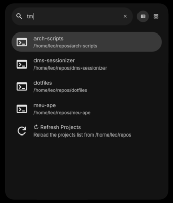

# DMS Sessionizer



A Dux Shell (formerly DankMaterialShell, DMS) launcher plugin that opens your projects in tmux or Zellij sessions. Pick a project directory in the launcher and the plugin opens your terminal attached to a session named after that directory.

Inspired by ThePrimeagen's tmux-sessionizer and tonybanters's dmenu-scripts.

## Features

- **Quick Project Access** - Browse project directories from the launcher
- **Multiple Directories** - Scan several project roots at once, and add single directories (e.g. `~/dotfiles`) as projects
- **tmux or Zellij** - Uses the multiplexer selected in DMS Settings → System → Multiplexers
- **Smart Session Handling** - Attaches to existing sessions instead of creating duplicates
- **Running Sessions** - Lists running sessions that don't match a project, so you can attach to them
- **Adhoc Sessions** - Type a name that matches nothing to create a new session in your home directory
- **Kill Sessions** - Type the kill prefix (default `!`) before a name to kill a running session
- **Sort by Recency** - Optionally show the most recently opened projects first
- **Multiple Terminal Support** - Works with st, alacritty, kitty, wezterm, foot, konsole, gnome-terminal, xterm, ghostty, or any custom terminal
- **Flexible Terminal Behavior** - Open new windows, kill existing terminals, or switch an existing tmux client
- **Search** - Filter projects by typing any part of the name or path

## Installation

### From Plugin Registry (Recommended)

#### Via DMS Settings UI

1. Open DMS Settings
2. Go to the **Plugins** tab
3. Click the **Browse** button
4. Search for "DMS Sessionizer" and click **Install**
5. Restart your DMS session

#### Via dms CLI

```bash
# Install the plugin
dms plugins install dmsSessionizer

# Restart DMS to load the plugin
dms restart
```

Visit [plugins.duxlabs.dev](https://plugins.duxlabs.dev/) for the full plugin registry.

### Manual Installation

```bash
# Clone the plugin repo to the plugins directory
# Dux Shell 2.x:
git clone https://github.com/leonardofranco01/dms-sessionizer ~/.config/dms/plugins/dmsSessionizer
# Older DMS releases use ~/.config/DankMaterialShell/plugins/ instead

# Enable in DMS
# 1. Open Settings
# 2. Go to Plugins tab
# 3. Click "Scan for Plugins"
# 4. Toggle "DMS Sessionizer" to enable

# Note: when using this method you'll also have to update the plugin manually.
```

### Nix

The repository is a flake. `packages.<system>.default` is the plugin directory, ready to drop into a plugins directory. With the Dux Shell NixOS module:

```nix
# flake inputs
inputs.dms-sessionizer.url = "github:leonardofranco01/dms-sessionizer";

# configuration
programs.dux-shell.plugins.dmsSessionizer = {
  enable = true;
  # mkForce overrides the registry package with this flake's build
  src = lib.mkForce inputs.dms-sessionizer.packages.${pkgs.stdenv.hostPlatform.system}.default;
};
```

## Usage

### Default Trigger Mode

1. Open launcher
2. Type `tm` to activate the plugin
3. Browse or search your projects
4. Press Enter to open the selected project in a terminal with your multiplexer

### Examples

- `tm` - Show all projects and running sessions
- `tm myapp` - Filter projects containing "myapp"
- `tm work/client` - Search by path segments
- `tm scratch` - If nothing matches, offers "Create new session: scratch"
- `tm !` - List running sessions to kill
- `tm !work` - Kill the session named "work"

### What Happens When You Select a Project

1. Plugin checks if a session with that name already exists
2. If session exists → attaches to it
3. If session doesn't exist → creates a new session with:
    - Session name = directory name (a leading `.` is dropped)
    - Working directory = project path
4. Opens your configured terminal with the session

## Configuration

Access settings via DMS Settings → Plugins → DMS Sessionizer:

### Projects Directories

- **Directory Paths**: Comma-separated list of paths
    - A path **ending in `/`** is scanned, and each subdirectory becomes a project: `~/projects/`
    - A path **without a trailing `/`** is added as a single project: `~/dotfiles`
    - Supports absolute paths (`/home/user/code/`), `~` expansion (`~/projects/`), and paths relative to home (`repos/` → `~/repos/`)
    - Example: `~/projects/, ~/work/, ~/dotfiles`
    - Default: `~/projects/`
- **Include Hidden Directories**: When enabled, includes directories that start with a dot (e.g., `.config`, `.local`)
- **Include Symlinked Directories**: When enabled, follows symbolic links and includes symlinked directories

> **Upgrading from 1.6.1 or earlier:** before 1.6.1 every path was scanned for subdirectories. On first load, version 1.6.2 adds a trailing `/` to each saved path that lacks one, so your existing list keeps working. Remove the `/` from any path you want as a single project.

### Terminal Settings

- **Terminal Emulator**: Choose from popular terminals:
    - st, alacritty, kitty, wezterm, foot, konsole, gnome-terminal, xterm, ghostty
    - Or select "Custom" for any other terminal
- **Custom Terminal** (when Custom selected): Command or path to your terminal executable
- **Terminal Behavior**: Controls how terminal windows are handled when opening sessions:
    - **newWindow** (default): Opens a new terminal window for each session
    - **killExisting**: Runs `pkill -x <terminal>` before launching. **This closes every open window of that terminal, including windows not opened by this plugin. Unsaved work in them is lost.** Only use it if that terminal is used exclusively for sessionizer sessions
    - **reuseSession**: Switches an existing tmux client to the new session without opening a new terminal. Falls back to opening a new window if no tmux client exists. tmux only; with Zellij a new window is always opened

### Multiplexer

The multiplexer (tmux or Zellij) comes from DMS Settings → System → Multiplexers. The plugin has no separate toggle.

### Trigger Settings

- **Always Active**: When enabled, projects always show in the launcher without needing a trigger
- **Trigger**: The keyword to activate the plugin (default: `tm`)
    - Examples: `tm`, `t`, `tmux`

### Kill Prefix

- **Deletion Prefix**: Text typed before a session name to kill it (default: `!`)

### Display Settings

- **Sort by Recency**: Show the most recently opened projects first (default: off, alphabetical)
- **Max Results**: Maximum number of items to display (default: 50)

## Requirements

- DMS >= 1.2.0 or Dux Shell 2.x
- tmux or Zellij
- A terminal emulator (st, alacritty, kitty, etc.)

## Compatibility

- **Compositors**: Compositor-agnostic (the plugin only starts processes). Used on Hyprland and niri
- **Distros**: Universal

## How It Works

The plugin:

1. Scans the configured project directories for subdirectories (and adds single-project paths as-is)
2. Displays them in the launcher with search
3. On selection, runs in your terminal:
    - tmux: `tmux new-session -As <project-name> -c <project-path>` (the `-A` flag attaches if the session exists, or creates it if not)
    - Zellij: `zellij attach <project-name>` if the session exists, otherwise `cd <project-path> && zellij -s <project-name>`

## Troubleshooting

### No projects showing

- Verify your projects directories exist and contain subdirectories
- Check that directories you want scanned end with `/` in the settings
- Try absolute paths
- Use the "↻ Refresh Projects" option in the launcher

### Terminal not launching

- Ensure your terminal emulator is installed and in PATH
- Try running the terminal from command line to verify it works
- For custom terminals, provide the full path if needed

### Session not created

- Check which multiplexer is selected in DMS Settings → System → Multiplexers
- tmux: verify it is installed (`which tmux`), list sessions (`tmux list-sessions`), try `tmux new-session -s test`
- Zellij: verify it is installed (`which zellij`), list sessions (`zellij list-sessions`), try `zellij -s test`

### Settings not applying

- Restart DMS after changing settings

## Contributing

Found a bug or want to add a feature? Open an issue or submit a pull request at [GitHub](https://github.com/leonardofranco01/dms-sessionizer)!

## Credits

### Inspired by

- [ThePrimeagen/tmux-sessionizer](https://github.com/ThePrimeagen/tmux-sessionizer) - The original tmux-sessionizer script for quickly switching between projects
- [tonybanters/dmenu-scripts](https://github.com/tonybanters/dmenu-scripts) - Tmux session management with dmenu/rofi
- [sr-tream/dms-vscode-launcher](https://github.com/sr-tream/dms-vscode-launcher) - A DMS launcher plugin that provides quick access to VS Code projects, directories, and more.

## License

MIT License - See LICENSE file for details
